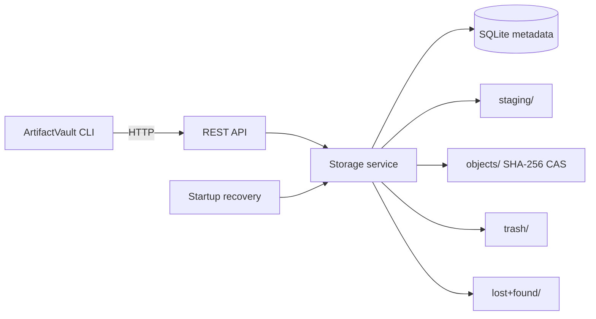

# ArtifactVault

ArtifactVault is a local-first, content-addressed artifact store for software and research teams. It stores arbitrary binary artifacts—builds, benchmark outputs, datasets, models, logs, and reports—under exact-byte SHA-256 identity and exposes them through a REST API and a single-binary CLI.

`SHA256(exact bytes)` is the storage identity. Filenames and tags are metadata, not identity.

## What it is for

ArtifactVault is useful when a team needs a small, scriptable artifact service without adopting a distributed artifact platform. Typical uses include:

- preserving build and benchmark outputs by content rather than mutable filenames;
- deduplicating repeated binaries, datasets, models, logs, and reports;
- moving artifacts between local/internal workflows through a stable CLI or HTTP contract;
- verifying stored bytes before they are reused;
- retaining independent metadata records for identical content.

It deliberately targets one service process, one local filesystem, and one SQLite database. It is not a multi-node registry, an experiment-tracking platform, or an object-storage replacement.

## Architecture



The CLI depends only on the HTTP contract. The storage service owns content identity, lifecycle locking, integrity verification, recovery, and garbage collection. SQLite stores logical records and migration state; artifact bytes live in the filesystem CAS. See [`docs/architecture.md`](docs/architecture.md) for the detailed consistency and durability model.

## Integrity and lifecycle guarantees

- Uploads stream through a fixed 64 KiB buffer; artifact size does not determine process memory usage.
- Bytes are SHA-256 hashed while streaming to a staging file, `fsync`ed, then finalized into a hash-derived object path before metadata is committed.
- Identical bytes share one physical object. Separate uploads can retain separate logical metadata records.
- Failed uploads do not create valid logical artifact records.
- Downloads are allowed only for active logical records and are re-hashed before any bytes are returned.
- HTTP byte ranges are supported for content retrieval.
- Verification reports `verified`, `missing_physical_object`, `corrupted_object`, or `metadata_inconsistency`; it does not silently repair corruption.
- Logical deletion does not directly remove bytes. Garbage collection removes an object only after all logical records are deleted and the grace period has elapsed.
- Active content reads hold a lease that blocks destructive lifecycle operations until the read completes.

## Quick start

Docker Compose is the simplest path:

```bash
docker compose up --build
```

The API listens on `http://127.0.0.1:8080` by default.

Native development requires Go 1.23+, a C compiler, `pkg-config`, and SQLite development headers (`libsqlite3-dev` on Debian/Ubuntu):

```bash
make test
make build
ARTIFACTVAULT_DB_PATH=./data/artifactvault.db \
ARTIFACTVAULT_STORAGE_ROOT=./data/storage \
./bin/artifactvault serve
```

## CLI

The CLI defaults to `http://127.0.0.1:8080`. Set `ARTIFACTVAULT_URL` to use another endpoint.

```bash
artifactvault upload --tag benchmark --description "run 42" results.tar.zst
artifactvault list --tag benchmark --limit 25
artifactvault get --output restored.tar.zst <SHA256>
artifactvault verify <SHA256>
artifactvault delete <SHA256>
artifactvault gc
artifactvault health
```

If several active logical records retain the same SHA-256, deletion by hash is intentionally rejected as ambiguous. Select the logical record explicitly:

```bash
artifactvault delete --record <RECORD_UUID> <SHA256>
```

To override the configured grace period for a manual collection:

```bash
artifactvault gc --grace 0s
```

## REST API

The committed OpenAPI 3.1 document is [`api/openapi.json`](api/openapi.json) and is served at `GET /openapi.json`.

| Method | Route | Purpose |
|---|---|---|
| `POST` | `/artifacts` | Stream an artifact into the vault |
| `GET` | `/artifacts` | List active logical records with filters and keyset pagination |
| `GET` | `/artifacts/{sha256}` | Read physical identity and active logical metadata |
| `GET` | `/artifacts/{sha256}/content` | Retrieve exact bytes, including HTTP Range support |
| `DELETE` | `/artifacts/{sha256}` | Logically delete a selected retention record |
| `POST` | `/artifacts/{sha256}/verify` | Recompute and report integrity state |
| `POST` | `/gc` | Run grace-aware physical collection |
| `GET` | `/health/live` | Process liveness |
| `GET` | `/health/ready` | Recovery, SQLite, and writable-storage readiness |
| `GET` | `/metrics` | Prometheus text counters |

Upload metadata is carried in `X-Artifact-Filename`, `X-Artifact-Tags`, `X-Artifact-Description`, and `Content-Type`. See [`docs/api.md`](docs/api.md) for error, filter, deletion, and verification semantics.

## Storage layout

```text
<data>/
  artifactvault.db
  storage/
    staging/      # in-progress uploads; never valid artifacts
    objects/aa/bb/<sha256>
    trash/        # crash-safe GC staging
    lost+found/   # old finalized orphans with no metadata
```

SQLite uses WAL mode, `synchronous=FULL`, foreign keys, and versioned migrations under `internal/db/migrations/`.

## Configuration

Server configuration is environment-based. [` .env.example`](.env.example) documents all supported variables, including database/storage paths, bind address, GC grace, staging TTL, metadata limits, optional maximum artifact size, and log level.

The default server bind is `127.0.0.1:8080`. The container listens on `0.0.0.0:8080` inside the container, while the supplied Compose file publishes it only on host loopback.

## Testing and verification

```bash
make fmt
make vet
make test
make race
make build
```

CI checks formatting, `go vet`, race-enabled tests, binary build, the full migration up/down/up path, Docker Compose validity, image build, and a live container readiness probe. The test suite covers content identity, bounded-memory ingestion, deduplication, corruption detection, deletion/GC rules, migration behavior, recovery states, concurrency, API semantics, and CLI failure handling.

See [`docs/verification.md`](docs/verification.md) for the verification boundary and what is intentionally not claimed.

## Operations

`/health/live` proves only that the HTTP process responds. `/health/ready` additionally checks startup recovery state, SQLite access, and a real create/write/fsync/remove probe in staging storage. Structured server logs are JSON.

Backup, restore, corruption, recovery, garbage collection, and rollback procedures are documented in [`docs/operations.md`](docs/operations.md).

## Limitations and trust boundary

ArtifactVault is intended for trusted local/internal deployment. Authentication/authorization, multi-tenancy, TLS termination, distributed locking, multiple independent writers, object-store backends, Kubernetes, and internet-facing hardening are outside the current product boundary.

Multiple clients may use one ArtifactVault server concurrently. Multiple independent ArtifactVault server processes sharing the same SQLite database and storage root are not a supported consistency model.

See [`SECURITY.md`](SECURITY.md) for the security boundary and operator responsibilities.

## License

ArtifactVault is source-available under the repository's proprietary [`LICENSE`](LICENSE). Public source availability does not grant open-source usage, modification, deployment, or redistribution rights.
