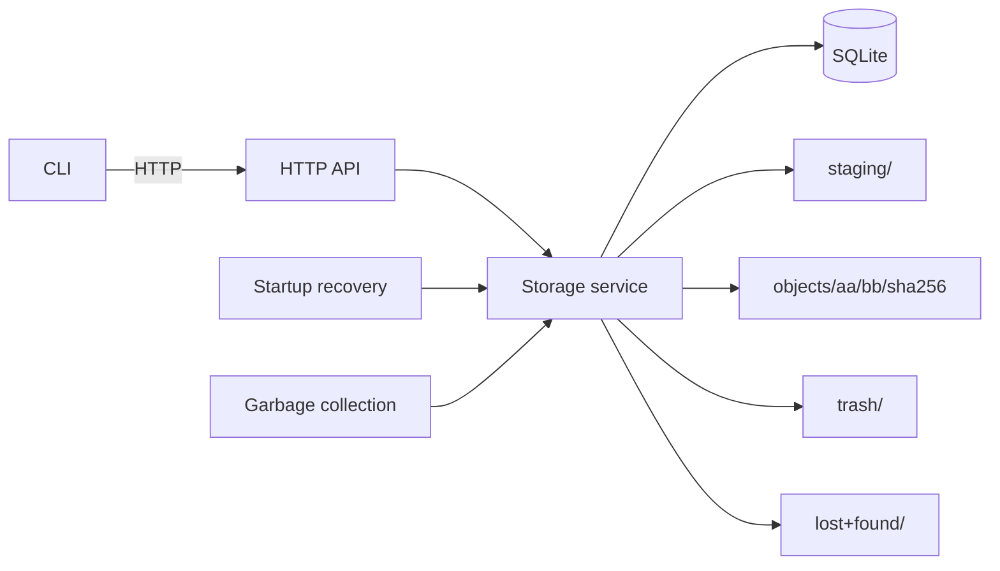

# Architecture

ArtifactVault is intentionally a single-node system: one service process, one local filesystem, and one SQLite database. The architecture is optimized for exact-byte identity, durable local ingestion, conservative recovery, and simple scripted access rather than distributed coordination.

## System topology



The components have deliberately narrow responsibilities:

- **CLI** — client-side UX only; it depends on the HTTP contract rather than database or filesystem internals.
- **HTTP API** — request validation, transport semantics, status/error mapping, health endpoints, OpenAPI serving, and metrics exposure.
- **Storage service** — content identity, streaming ingestion, lifecycle locking, integrity verification, deletion, garbage collection, and recovery.
- **SQLite adapter** — durable logical metadata, object references, timestamps, and versioned migrations.
- **Filesystem CAS** — staged uploads, finalized SHA-256-addressed objects, crash-safe GC staging, and quarantined orphaned objects.

No component derives a filesystem path from an unvalidated user path. Final object paths are derived only from validated SHA-256 values.

## Ingestion state machine

```text
request body
  -> staging file
  -> stream SHA-256 + size
  -> fsync staging file
  -> lifecycle write lock
  -> finalize into hash-derived CAS path
  -> sync containing directory
  -> SQLite transaction
  -> response
```

A staging file has no artifact identity. Finalization uses a same-filesystem hard link so an existing destination is never overwritten. If the final object already exists, ArtifactVault recomputes its SHA-256 before reuse. Metadata is inserted only after finalized bytes exist.

If metadata insertion fails after a new final object was created, the object is removed before the upload returns failure. A crash in the narrow finalization-before-commit window can leave an untracked finalized object; startup recovery never invents metadata and eventually quarantines old untracked objects to `lost+found/`.

## Physical objects and logical records

`objects.sha256` is the physical content identity. `artifact_records` are logical retention and metadata records. Many logical records may reference one physical object, and tags belong to logical records.

That separation allows repeated uploads of identical bytes to deduplicate storage while retaining independent filename, tag, description, and creation metadata.

Deletion marks one logical record deleted. If a hash has several active records and the caller omits `record_id`, the request fails rather than guessing. `objects.unreferenced_at` is set only when the active reference count reaches zero.

## Read and lifecycle concurrency

One ArtifactVault process may serve many clients concurrently. Upload bodies stage concurrently; finalization and metadata lifecycle transitions are serialized briefly by a process-local lifecycle write lock.

Content reads hold a read lease for the duration of integrity pre-verification plus `ServeContent`. This prevents delete or GC from racing an active read. Before any download bytes are sent, the physical object is re-hashed and compared with its SHA-256 identity, so same-size corruption is rejected rather than streamed.

SQLite is opened in full-mutex mode and the adapter serializes use of its single connection.

ArtifactVault does **not** claim correctness for multiple independent server processes sharing the same SQLite database and storage root. Supporting that topology would require an inter-process lifecycle lock or a different transactional storage protocol.

## Garbage collection and crash safety

GC selects only objects whose `unreferenced_at` is older than the configured grace cutoff. Under the lifecycle write lock it:

1. rechecks active retention;
2. renames the object into `trash/`;
3. deletes logical/database state transactionally;
4. unlinks the trash entry after commit.

If the database transaction fails, the object is renamed back. If the process crashes mid-operation, startup recovery restores the trash entry when the database row still exists or removes it when metadata deletion already committed.

## Startup recovery

Recovery is conservative:

- stale staging files are removed after the configured TTL;
- interrupted GC entries are restored or removed according to database state;
- old canonical objects with no metadata row are moved to `lost+found/` rather than silently imported;
- externally missing or corrupted objects are never repaired implicitly.

A partial recovery failure is retained as readiness state. The process can remain live for diagnosis while `/health/ready` returns 503.

## Durability contract

Upload success is returned only after staged bytes are fsynced, finalized into the CAS, the containing directory sync succeeds, and a `synchronous=FULL` SQLite transaction records the object/reference.

This is a local-filesystem durability model. Filesystem, storage-device, controller, and host power-loss guarantees outside the application remain deployment responsibilities.
